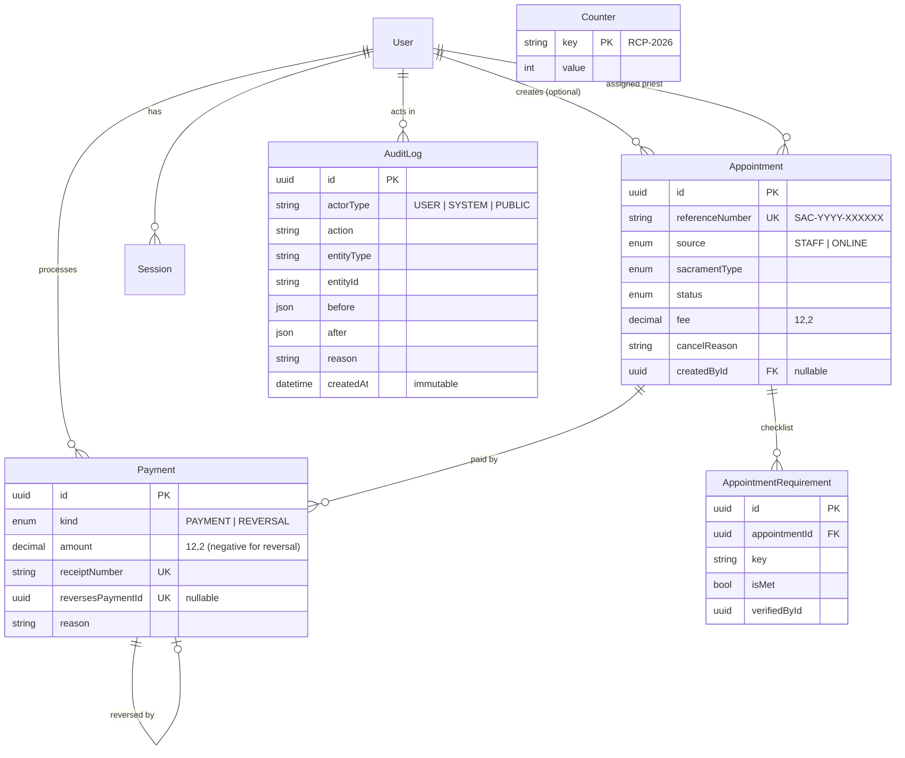

# Product Requirements Document — Parish Sacrament System

| | |
|---|---|
| **Product** | Parish Sacrament System (Immaculate Conception Cathedral Parish, Urdaneta City, Pangasinan) |
| **Document status** | Draft v1.0 — Release 1 implemented on branch `feature/phase-1-foundations-and-online-booking` |
| **Date** | 2026-11-23 |
| **Governing document** | `.specify/memory/constitution.md` v1.0.0 (wins over this PRD on any conflict) |
| **Related** | `specs/001-upgrade-tech-stack` (platform upgrade — independent of this PRD, must not be blocked by it) |

---

## 1. Summary

The system today is a staff-only tool: an admin, priests and cashiers log in to record sacrament
appointments, take cash/GCash payments and print reports. It works, but three things stand between
it and what the parish actually needs:

1. **Parishioners cannot self-serve.** Every booking needs an office visit or call. The constitution
   (Principle I) makes online booking the reason the system exists.
2. **Scheduling and money are not trustworthy enough for an audit.** Nothing stops a priest being
   double-booked, any status can be set to any other, receipt numbers are random, money is stored as
   floating point, and there is no record of who changed what.
3. **Staff have no overview.** There is no calendar, no checklist of what a family must bring, and
   no way to reverse a wrong payment.

This PRD defines the next set of features, orders them, and specifies **Release 1**, which fixes the
trust gaps first (because every later feature depends on them) and delivers the parishioner-facing
booking flow on top of them.

## 2. Goals and non-goals

### Goals
- G1. A parishioner can see what a sacrament requires, request a date, and track the request — on a phone, without an account.
- G2. Parish staff stay in control: nothing is confirmed until staff say so.
- G3. A priest can never be double-booked; invalid status changes are impossible.
- G4. Every peso is traceable; mistakes are corrected by reversing entries, never by edits.
- G5. Every change to an appointment or payment leaves an immutable audit record.
- G6. Staff see their month at a glance.

### Non-goals (Release 1)
- Online payment gateway (needs provider credentials and webhook infrastructure — Release 3).
- SMS/email notifications (needs provider choice and sender registration — Release 2).
- Sacramental certificates and the parish register (needs a privacy/retention decision first — Release 2).
- Replacing the in-flight tech-stack upgrade (`specs/001-upgrade-tech-stack`).

## 3. Users

| Persona | Needs | Current gap |
|---|---|---|
| **Parishioner** (non-technical, on a phone) | Know requirements, request a date, know the status, never be told something is confirmed when it is not | No public access at all |
| **Parish secretary / Admin** | Triage requests, assign priests, avoid clashes, see the month, correct mistakes with a paper trail | No calendar, no conflict checks, free-form status edits, no audit |
| **Priest** | See *my* schedule, mark done | List only; no calendar |
| **Cashier** | Take payment, reconcile the day, reverse a wrong entry via admin | Random receipt numbers, no duplicate-payment guard, no reversal |
| **Parish priest / Auditor** | Trust that books reconcile | Float money, no audit trail |

## 4. Current state (from the ER model and code review)

Entities today: `User` (ADMIN/PRIEST/CASHIER), `Session`, `Appointment` (7 sacrament types, 4 statuses),
`Payment` (CASH/GCASH). Reports exist for all three staff roles and export to PDF.

Findings that shape the plan (constitution gaps are marked ⚖):

| # | Finding | Where | Impact |
|---|---|---|---|
| F-1 ⚖ | `Appointment.fee` and `Payment.amount` are `Float` | `schema.prisma` | Rounding drift in totals; Principle II forbids it |
| F-2 ⚖ | No audit log of any kind | — | Cannot answer "who changed this?" |
| F-3 | Receipt number = `RCP-YYYY-` + `Math.random()` (5 digits) | `lib/auth.ts` | Collisions at ~300 receipts/year; a collision makes the payment fail with a 500 |
| F-4 | Payment amount is trusted from the client; no check against fee or prior payments | `api/payments` | Wrong or duplicate payments possible |
| F-5 | Payment insert and appointment-confirm are two separate writes | `api/payments` | Half-applied payment on failure |
| F-6 | `PUT /appointments/:id` accepts any status → any status | `api/appointments/[id]` | A completed or cancelled appointment can be reopened silently |
| F-7 | No clash detection when assigning a priest or choosing a slot | `api/appointments` | Double-booked funerals/weddings |
| F-8 | `GET /appointments` performs writes (auto-complete) with no record | `api/appointments` | Silent, unaudited state changes |
| F-9 | `createdById` is required, so a booking cannot exist without a staff user | `schema.prisma` | Blocks any public booking |
| F-10 ⚖ | No runtime input validation; hand-picked fields from `request.json()` | all routes | Malformed data reaches the DB |
| F-11 ⚖ | No automated tests | — | Principle VI requires them for money and scheduling |
| F-12 | `/api/reports` is not in `proxy.ts` protected list (the route handlers still check the session) | `proxy.ts` | Defence in depth gap only |
| F-13 | Cancelling a paid appointment says nothing about the money | `api/appointments/[id]` DELETE | Violates Principle IV |

## 5. Feature roadmap

| ID | Feature | Release | Priority |
|---|---|---|---|
| **R1-1** | Exact money (Decimal + centavo helpers) | 1 | P0 |
| **R1-2** | Immutable audit log + admin viewer | 1 | P0 |
| **R1-3** | Appointment lifecycle state machine | 1 | P0 |
| **R1-4** | Scheduling conflict prevention | 1 | P0 |
| **R1-5** | Payment integrity: sequential receipts, balance guard, atomic confirm, void/refund | 1 | P0 |
| **R1-6** | Calendar view (admin + priest) | 1 | P1 |
| **R1-7** | Sacrament requirements checklist | 1 | P1 |
| **R1-8** | Public booking request + status tracking | 1 | P0 |
| R2-1 | Notifications (SMS/email): request received, confirmed, reminder | 2 | P1 |
| R2-2 | Sacramental certificates (PDF) + parish register | 2 | P1 |
| R2-3 | Parishioner records (link people ↔ appointments) | 2 | P2 |
| R2-4 | Fee schedule admin (per sacrament defaults) | 2 | P1 |
| R2-5 | Priest leave / recurring commitments | 2 | P1 |
| R2-6 | Scheduled auto-complete job (remove writes from GET) | 2 | P1 |
| R2-7 | Staff password change / reset, login throttling | 2 | P1 |
| R3-1 | Online payment (GCash/PayMongo-class gateway, webhook-verified) | 3 | P1 |
| R3-2 | Data-privacy tooling (export, correction, erasure requests) | 3 | P2 |
| R3-3 | Analytics dashboard (volume by sacrament/barangay, collections trend) | 3 | P2 |

**Ordering rationale.** R1-1 to R1-5 come first because online booking and online payment multiply
the volume of records; fixing money, audit and scheduling *after* opening the front door would mean
migrating live data under load. R1-8 is the parishioner-facing deliverable. Notifications (R2-1) is
next because a request with no feedback loop makes parishioners phone the office anyway.

## 6. Release 1 — requirements

Requirement IDs are referenced from code comments and tests.

### R1-1 Exact money
- FR-1.1 `Appointment.fee` and `Payment.amount` are stored as `DECIMAL(12,2)`. Existing values are preserved (rounded to 2 dp).
- FR-1.2 All server-side money arithmetic uses integer centavos (`lib/money.ts`); no floating-point addition of amounts.
- FR-1.3 API input amounts are rejected unless positive-or-zero with at most 2 decimal places.
- FR-1.4 API responses carry amounts as JSON numbers with ≤ 2 dp so existing clients keep working.
- **Acceptance:** summing 0.10 + 0.20 across 1,000 payments yields exactly the expected total; the migration leaves every row's amount equal to its previous value to the centavo.

### R1-2 Audit log
- FR-2.1 `AuditLog` captures: actor (id, name, role — or `SYSTEM` / `PUBLIC`), action, entity type, entity id, before/after snapshot, optional reason, UTC timestamp.
- FR-2.2 Written for: appointment create/update/status-change/cancel, payment create/reversal, requirement checks, user create/update/delete, auto-complete (as `SYSTEM`).
- FR-2.3 Immutable: the application exposes no update/delete; a database trigger rejects `UPDATE` and `DELETE` on the table.
- FR-2.4 Admin-only "Audit Log" tab: filter by entity type and date range, paged, shows who/what/when and before→after.
- FR-2.5 Audit writes happen in the **same transaction** as the change they describe.
- FR-2.6 Snapshots never contain password hashes or session tokens.
- **Acceptance:** every mutation endpoint listed above produces exactly one audit row; attempting `UPDATE`/`DELETE` on `AuditLog` via SQL fails.

### R1-3 Appointment state machine
```
PENDING ──► CONFIRMED ──► COMPLETED
   │            │
   └────────────┴──► CANCELLED        (COMPLETED and CANCELLED are terminal)
```
- FR-3.1 Transitions are enforced server-side in one function (`lib/appointments/stateMachine.ts`); invalid transitions return `409`.
- FR-3.2 System-only transitions: auto-complete (`PENDING|CONFIRMED → COMPLETED` once the date has passed — existing behaviour, now audited) and payment-driven `PENDING ↔ CONFIRMED`.
- FR-3.3 The admin edit form offers only the statuses reachable from the current one.
- FR-3.4 A priest may only move their own appointment to `COMPLETED`.
- **Acceptance:** unit tests cover every (from, to, actor) combination; an API call that reopens a cancelled appointment is rejected.

### R1-4 Scheduling conflict prevention
- FR-4.1 Each sacrament type has a duration and a rule: **exclusive** (one priest/one venue at a time: wedding, funeral, anointing) or **grouped** (several families may share one ceremony *starting at the same time*: baptism, first communion, confirmation, mass intention).
- FR-4.2 Assigning a priest is rejected (`409`) if they have an overlapping appointment on the same date, unless both are the same grouped type starting at the same time.
- FR-4.3 Assigning a priest who is inactive or on day-off is rejected.
- FR-4.4 The check and the write run in one transaction guarded by a Postgres advisory lock keyed on (priest, date), so two concurrent requests cannot both succeed.
- FR-4.5 Times are compared as minutes-since-midnight, never as strings. Calendar dates are Philippine dates (`Asia/Manila`).
- FR-4.6 Cancelled and soft-deleted appointments do not block a slot.
- **Acceptance:** two simultaneous assignments of one priest to one slot → exactly one succeeds (integration test against a real Postgres).

### R1-5 Payment integrity
- FR-5.1 Receipt numbers are sequential per year (`RCP-2026-00042`), allocated from a counter row inside the payment transaction.
- FR-5.2 The server rejects a payment whose amount exceeds the appointment's outstanding balance, or when the appointment is cancelled.
- FR-5.3 Payment insert, receipt allocation, appointment status change and audit row commit atomically.
- FR-5.4 **Void/refund:** an admin can reverse a payment with a mandatory reason. This writes a *new* `REVERSAL` row (negative amount, `RVS-YYYY-NNNNN`, referencing the original). The original is never edited. A payment can be reversed once.
- FR-5.5 If voiding leaves a `CONFIRMED` appointment with no net payment, it returns to `PENDING`.
- FR-5.6 **Cancellation:** cancelling an appointment requires a reason. If it has a net payment, the admin must choose `REFUND` (reversal entries are written) or `FORFEIT` (money retained, recorded in the audit log).
- FR-5.7 Daily and range totals (cash, GCash, total) are net of reversals.
- **Acceptance:** 100 concurrent payments produce 100 distinct, gap-free receipt numbers; a paid-then-voided appointment nets to ₱0.00 in reports and shows both entries.

### R1-6 Calendar
- FR-6.1 Month grid showing appointment counts per day, colour-coded by status; click a day for its list (time, sacrament, participant, priest, status).
- FR-6.2 Admin sees everything; a priest sees only their assignments (server-enforced).
- FR-6.3 Month navigation; "today" highlighted.

### R1-7 Requirements checklist
- FR-7.1 Each sacrament has a defined requirement list (e.g. baptism: PSA birth certificate, parents' marriage certificate, godparents' confirmation certificates, pre-baptismal seminar).
- FR-7.2 Requirements are shown to the parishioner **before** they submit a booking.
- FR-7.3 Staff tick requirements off per appointment (who/when recorded and audited).
- FR-7.4 The appointment list shows `n/m requirements met`.
- **Assumption — to confirm with the parish:** the requirement lists in `lib/requirements.ts` are a sensible Philippine-parish default, not the parish's official list.

### R1-8 Public booking and tracking
- FR-8.1 `/book` (no login): choose sacrament → read requirements → pick date/time from available slots → enter contact details → submit.
- FR-8.2 Result: a reference number (`SAC-2026-K7M4QX`) and the message "Request received — not yet confirmed".
- FR-8.3 `/track`: reference number **plus** the phone or email used. Shows only status, sacrament, date/time, and amount due/paid. No other personal data.
- FR-8.4 Public requests are always `PENDING`, `source = ONLINE`, with no staff creator. Fee is `0` until staff set it — the parish decides fees, the system does not invent them.
- FR-8.5 Slot availability: working slots, minimum lead time (3 days), maximum horizon (180 days), per-sacrament capacity. Pending and confirmed requests count against capacity.
- FR-8.6 Abuse protection: per-IP rate limit, honeypot field, all input validated with Zod, no enumeration (tracking errors are identical for "wrong reference" and "wrong contact").
- FR-8.7 Mobile-first (usable at 360px), labelled inputs, keyboard-navigable.
- **Acceptance:** a request submitted at `/book` appears in the admin appointment list as `PENDING / ONLINE` and in the audit log as `PUBLIC`; tracking with a wrong phone number reveals nothing.

## 7. Target data model (Release 1)



Migration notes: `fee`/`amount` → `DECIMAL(12,2)` via `ROUND(x::numeric, 2)`; existing appointments are
back-filled with reference numbers; `createdById` becomes nullable; no data is deleted.
The migration is additive apart from those type changes, and is generated as SQL for review before
anyone applies it to production.

## 8. Non-functional requirements

- **Security / privacy:** server-side authorization on every handler; Zod validation on all input; public endpoints expose the minimum personal data; RA 10173 — collect only what the sacrament needs, never log personal data in plaintext.
- **Accessibility:** public pages meet WCAG 2.1 AA basics (labels, focus order, contrast, no colour-only status).
- **Performance:** calendar month query and availability query each ≤ 1 DB round-trip with indexed `scheduledDate`; audit log paged at 50 rows.
- **Compatibility:** no change to existing staff workflows other than the new guards; existing API shapes keep working (amounts remain JSON numbers).
- **Time:** stored UTC / date-only; displayed `Asia/Manila`.
- **Tests:** unit tests for money, state machine, conflict rules, receipt format, slot generation; integration tests against Postgres for concurrency (conflicts, receipts) and audit immutability.
- **Operations:** `.env.example` documents configuration; migration shipped as reviewed SQL.

## 9. Success metrics

| Metric | Target (90 days after launch) |
|---|---|
| Share of bookings that start online | ≥ 40% |
| Double-booking incidents | 0 |
| Daily reconciliation discrepancies (cash + GCash vs. records) | 0 |
| Payments needing admin reversal | tracked, each with a recorded reason |
| Office phone calls asking "is my request confirmed?" | down by half (needs R2-1 notifications) |

## 10. Risks, assumptions and open questions

| # | Item | Owner | Default if unanswered |
|---|---|---|---|
| Q1 | Are the requirement lists in `lib/requirements.ts` the parish's official ones? | Parish office | Use defaults; editable in code until R2-4 |
| Q2 | May two baptisms/communions/confirmations share a priest at the same start time? | Parish priest | Yes (grouped), exclusive for weddings/funerals/anointing |
| Q3 | Bookable hours and days (currently Mon–Sat, 08:00–11:00 & 14:00–16:00 hourly) | Parish office | As stated; one constant to change |
| Q4 | Capacity per slot for grouped sacraments (currently 10) | Parish office | 10 |
| Q5 | Public-request fee: parish sets it at confirmation | Parish office | `0` until staff set it |
| Q6 | Retention period for financial/audit records | Diocese / BIR rules | Never delete; documented as indefinite |
| R1 | Rate limiting is in-memory per instance; on Vercel serverless it is best-effort only | Eng | Move to a shared store (Redis/Upstash) in R2 |
| R2 | Auto-complete still runs on read (now audited) | Eng | Replaced by a scheduled job in R2-6 |
| R3 | Merge conflicts with `001-upgrade-tech-stack` (Next/React/TS bumps touch `package.json`, `tsconfig.json`, components) | Eng | Release 1 avoids touching framework config beyond adding `zod` and `vitest` |
| R4 | `next lint` no longer exists in Next 16; lint gate is part of spec 001 | Eng | Type-check + tests + build are the gates here |

## 11. Rollout

1. Review the generated migration SQL on a copy of production data (record counts and per-day payment totals must match before/after — spec 001's snapshot method applies).
2. Merge via pull request (constitution: no direct commits to `main`).
3. Apply migration, deploy. Public booking is reachable at `/book` immediately; hide the link until the office is ready by not linking it from the login page (the page also has a kill switch: env `PUBLIC_BOOKING_ENABLED=false`).
4. Brief the secretary on the new flow: *online requests arrive as PENDING → set fee → assign priest → confirm*.
